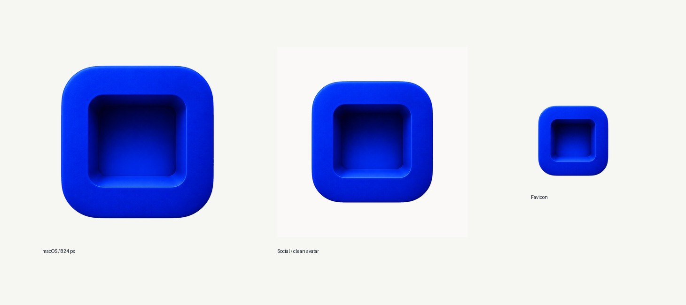

# Stou brand assets

The Stou icon is **The Well, Blue**: a cobalt tile with a deep square well to
drop things into. The blue is Klein-inspired cobalt/ultramarine (`#0826E1` as
a web theme colour), not a measured International Klein Blue.

All files are raster exports of one artwork; there is no vector source.

The brand voice and the App Store screenshot plan are in [`docs/brand`](../docs/brand).

<p align="center"></p>

## The app icon

The app's icon lives in [`Resources/AppIcon.appiconset`](../Resources/AppIcon.appiconset),
a standard Xcode asset with all ten macOS sizes, each made from the 1024 px
master. It is the only source: `scripts/build-app.sh` turns it into `Stou.icns`
when it builds the app, so no `.icns` is kept in the repository. To change the
icon, replace those PNGs at the same sizes and names.

The icon follows the macOS icon grid: on its 1024 × 1024 canvas the tile is
824 × 824 px with 100 px of transparent margin, so it sits at the same visual
size as other apps in the Dock.

## In this folder

| Path | What it is |
| --- | --- |
| `icon/stou-icon-1024.png` | Master icon, 1024 × 1024 on the macOS grid, transparent background. Use this wherever the icon appears on its own. |
| `icon/stou-icon-1024-offwhite.png` | The same icon flattened onto off-white, for previews only. Never use it as an app icon. |
| `social/stou-avatar-light-{1024,512}.png` | Primary square avatar on a light background, with room for round crops. |
| `social/stou-avatar-midnight-{1024,512}.png` | The same avatar on a dark background. |
| `github/stou-readme-cover.png` | 1672 × 941 cover with the line “Drop files. Stou takes it from there.”; the top of the README. |
| `favicon/` | Website icons: `favicon.ico`, PNGs from 16 to 512 px plus a 1024 px master, a 180 px opaque `apple-touch-icon.png` and a sample `site.webmanifest`. |
| `preview/stou-assets-overview.jpg` | Overview of the icon at app, avatar and favicon size. |

Avatars are sized for profile pictures, with more margin than the app icon:
platforms crop them to a circle.

For a website, copy `favicon/` to the site root and add:

```html
<link rel="icon" href="/favicon.ico" sizes="any">
<link rel="icon" type="image/png" sizes="32x32" href="/favicon-32x32.png">
<link rel="apple-touch-icon" href="/apple-touch-icon.png">
<link rel="manifest" href="/site.webmanifest">
```

## Notes

- Small sizes are downsampled from the master; check them in the Dock,
  Finder and a browser tab.
- The icons have not been through App Store Connect validation.
